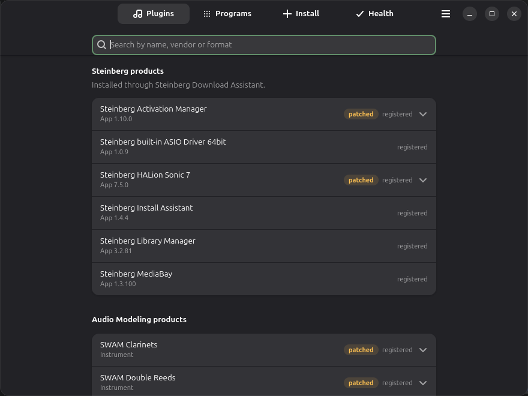
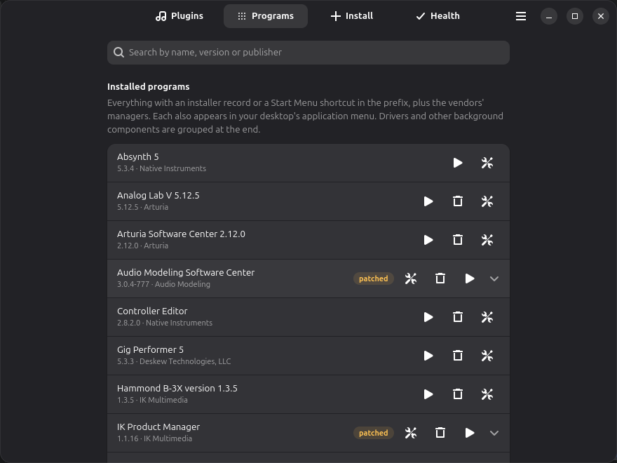
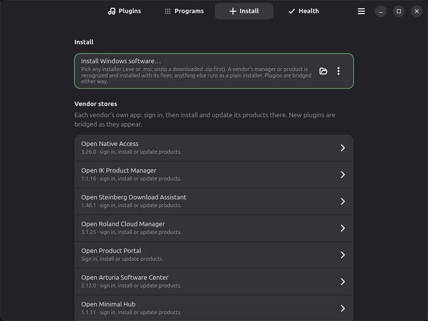
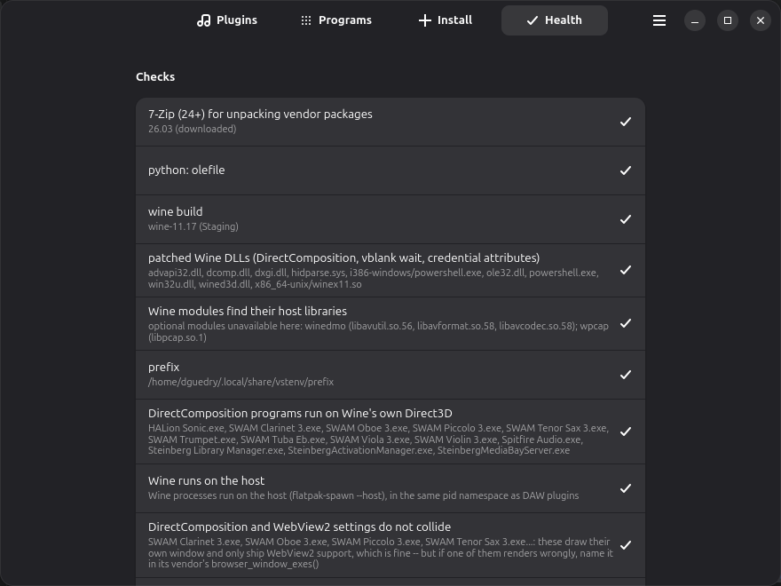

# VST Environment for Linux

**Use your Windows plugins and instruments in Linux music software.**

VST Environment (vstenv) installs Windows plugins and makes them show up in your
Linux DAW or plugin host (REAPER, Bitwig, Ardour,
[StageRig](https://github.com/dguedry/stagerig) and others) like any other plugin. It can
install them from a vendor's own app, like Native Access, or from a plain
installer you downloaded. It sets up and repairs the Windows compatibility layer
(Wine) for you, along with the many fixes plugins need under it, so you never
have to deal with it yourself.

It works with Native Instruments (Native Access, Kontakt and its libraries), IK
Multimedia, Steinberg, Arturia, iZotope, Softube, Audio Modeling, FabFilter,
Soundtoys, Valhalla, Xfer Serum 2 and more. See [What works](#what-works).

VST Environment is an independent, unofficial project. It isn't associated
with, endorsed by or supported by any of the companies whose software it
installs; it just helps their customers use the products they've bought on
Linux. If something doesn't work here, please [tell us](https://github.com/dguedry/vstenv/issues),
not the vendor's support. Product names and trademarks belong to their owners.

| Your plugins and what was installed | Windows programs: run, uninstall, troubleshoot |
|---|---|
|  |  |

| Install: vendor stores and any installer | Health: every check, with its fix |
|---|---|
|  |  |

**Contents:** [Install](#install) ·
[First start](#first-start) ·
[Installing your plugins](#installing-your-plugins) ·
[Using plugins in your DAW](#using-plugins-in-your-daw) ·
[When something doesn't work](#when-something-doesnt-work) ·
[What works](#what-works) ·
[Removing things and starting over](#removing-things-and-starting-over) ·
[Your files and disk space](#your-files-and-disk-space) ·
[Linux versions and desktops](#linux-versions-and-desktops) ·
[Questions](#questions)

## Install

You need Flatpak, which most Linux systems already have. If yours doesn't, see
[flatpak.org/setup](https://flatpak.org/setup/).

Open a terminal and paste these two lines:

```sh
flatpak remote-add --if-not-exists --user vstenv https://dguedry.github.io/vstenv/vstenv.flatpakrepo
flatpak install --user vstenv io.github.dguedry.vstenv
```

Then open **VST Environment** from your app menu (you'll find it under Audio or
Sound & Video). Updates arrive with your other Flatpak updates, or when you run
`flatpak update`.

<details>
<summary>Prefer a single file?</summary>

Download `vstenv.flatpak` from the
[latest release](https://github.com/dguedry/vstenv/releases/latest) and run
`flatpak install --user vstenv.flatpak` where you saved it. This copy does not
update itself; install the newer file again to update. The app needs the
Flathub remote for its runtime, which most systems already have.
</details>

## First start

The first time you open the app, it sets everything up by itself. This takes a
few minutes, once, and you can watch the progress on screen. It downloads its
own copy of Wine and creates the app's Windows folder: its own `C:` drive,
where your Windows programs and plugins will live. It also adds the fonts,
Windows runtimes and fixes plugins need. You don't need to install Wine or
anything else first, and nothing outside your home folder is changed.

The app has four tabs:

- **Plugins:** what you have installed, and the plugins your DAW can load.
- **Programs:** Windows programs, such as Kontakt's standalone version or a
  vendor's store app. Start them here; most also appear in your app menu.
- **Install:** vendor store apps, and **Install Windows software…** for anything
  you downloaded.
- **Health:** checks that everything is in order, and tells you how to fix what
  isn't.

## Installing your plugins

### Through a vendor's store app

Many companies install their products through their own app, such as Native
Access, IK Product Manager, Steinberg Download Assistant or Arturia Software
Center. On the **Install** tab:

1. Click **Get … from …** to open the vendor's download page, and download the
   app's Windows installer.
2. Click **Install Windows software…** and pick the file you downloaded. The app
   recognises it and installs it with the fixes it needs.
3. Click **Open …** and sign in. Install the products you want there, exactly as
   you would on Windows.

New plugins are made available to your DAW as they appear.

### From a file you downloaded

Click **Install Windows software…** on the **Install** tab and pick the file. You
can also right-click the file in your file manager and choose **Install with VST
Environment**. Any of these work:

- **An installer** (`.exe` or `.msi`). Its window opens, and you click through
  it as on Windows. If it asks where to put the plugin, keep the folder it
  suggests.
- **A `.zip` as you downloaded it**, with no need to unzip it first. If it holds
  an installer, that installer runs. If it holds the plugin files themselves
  (`.vst3`, `.clap` or `.dll`), the app copies them into place. Mac and 32-bit
  versions in the zip are skipped, and the app tells you which. A zip holding a
  large sound or content pack is unpacked into `~/.cache/vstenv` first; delete
  that copy once the install is done.
- **A single plugin file** (`.vst3`, `.clap` or `.dll`), or a folder holding
  plugins: use **Install plugins from a folder…** in the same menu.

When it's done, the plugins are ready for your DAW.

Where the right-click entry appears depends on your file manager:

| File manager | Where to find "Install with VST Environment" |
|---|---|
| Dolphin (KDE) or Nemo (Cinnamon) | right-click menu |
| Files (GNOME) | right-click → Scripts |
| Others | right-click → Open With → VST Environment |

## Using plugins in your DAW

Every Windows plugin you install is made available to your DAW automatically,
in these folders:

- `~/.vst3/yabridge` (VST3)
- `~/.clap/yabridge` (CLAP)
- `~/.vst/yabridge` (VST2)

Most Linux DAWs and hosts (REAPER, Bitwig, Ardour, Carla,
[StageRig](https://github.com/dguedry/stagerig)) already look in `~/.vst3` and
`~/.clap`. If yours doesn't list your plugins, add those folders in its plugin
settings and rescan. After installing something new while your DAW is open,
rescan its plugins.

A plugin appears once for each format it comes in, so one with both VST2 and
VST3 versions shows up twice. If your DAW only loads VST3, plugins that only
come as VST2 won't appear in it.

The bridge between your DAW and Windows plugins is
[yabridge](https://github.com/robbert-vdh/yabridge), and the app installs and
manages it for you. For playing live, the sister project
[StageRig](https://github.com/dguedry/stagerig) is a performance host that
loads these plugins too.

## When something doesn't work

1. **Look at the Health tab.** It checks everything the app depends on and tells
   you how to fix what's wrong. ☰ → **Re-run setup / repair** fixes most
   problems and is always safe to run.
2. **A program or plugin that draws wrong, flickers or misbehaves:** click the
   gear button beside it (on the Programs tab, or beside a plugin on the Plugins
   tab). **Troubleshoot** offers a few settings to try, each with a line on when
   it helps. Keep the one that works. **Share this recipe…** sends your fix to
   the project, so it can reach everyone else too.
3. **An installer that fails:** the app explains what went wrong where it can,
   and offers ways to run it again, with the most likely one first. **Share this
   failure…** reports it.
4. **Still stuck?** Click **Save a diagnostic report** on the Health tab, and
   [open an issue](https://github.com/dguedry/vstenv/issues) with it attached.
   The report leaves out your serial numbers, licence tokens and home folder path.

Known problems and what to do:

- **A store app's window stays white or black** (on some graphics drivers):
  switch on ☰ → **Software rendering for WebView2 apps**, then start the store
  app again.
- **On GNOME, a program starts but its window never appears**, and then no
  other Windows window appears either: this is a GNOME problem the app can't
  fix. Log out and back in.
- **SINE Player's sign-in fields don't show what you type.** The typing does
  work: click the email field, type your email, click the password field, type
  your password, then click Activate. Red text under the button tells you if
  you made a typo.
- **32-bit plugins aren't supported.** Use the 64-bit version, which almost
  every current plugin has.

## What works

| Vendor and product | Status |
|---|---|
| Native Instruments: Native Access, Kontakt 8, libraries, Komplete Kontrol | Works. Sign in, install, and play in a DAW |
| IK Multimedia: IK Product Manager, SampleTank, Hammond B-3X | Works. Plugin windows need a graphics driver with Vulkan, which most have |
| Steinberg: Download Assistant, HALion Sonic 7 | Works. Sign-in, installs, libraries, playing in a DAW |
| Arturia: Software Center, Analog Lab V | Works |
| iZotope: Product Portal, Ozone 9 | Works |
| Softube: Softube Central, Heartbeat | Works |
| Audio Modeling: Software Center, SWAM | Works. The Center reports its installs as failed; the app finishes them and tells you |
| FabFilter, Soundtoys (with iLok), Valhalla, Xfer Serum 2 | Work as they are |
| Gig Performer 5 | Works, as a standalone program |
| Minimal Audio: Minimal Hub, Squash | Works |
| Orchestral Tools: SINE Player | Works. Sign-in fields don't show your typing (see above) |
| Spitfire Audio app | Partly: it opens and browses; signing in and installing libraries not yet confirmed |
| Rayzoon: Jamstix 4 | Partly: the editor opens in a DAW; playback not yet confirmed |
| Roland Cloud Manager | Partly: it installs and opens; signing in not yet confirmed |

Tested mostly on Linux Mint 22.3 and Ubuntu 24.04. Something you use isn't
listed? Try it, and please report how it went.

## Removing things and starting over

- **Uninstall a program or plugin:** click the trash button beside it on the
  **Programs** tab. For Native Instruments products (Kontakt, Kontakt Player,
  libraries), use the trash button on the **Plugins** tab. Native Access then
  offers a clean **Install** again instead of **Repair**. Your licences stay on
  your account.
- **Start completely fresh:** ☰ → **Remove the environment…** deletes the app's
  Windows folder with everything installed in it. It also removes the plugins
  from your DAW's folders, and the app's menu and file manager entries. The next
  start sets everything up again.

Uninstalling the Flatpak alone does **not** remove the Windows folder, and
neither does deleting the app's data with `--delete-data`. Use **Remove the
environment…** first.

## Your files and disk space

| Folder | What is in it |
|---|---|
| `~/.local/share/vstenv/prefix` | The app's Windows folder (its `C:` drive): every program, plugin, library and sign-in. This is the big one, often tens of GB with sample libraries |
| `~/.local/share/vstenv` (the rest) | The app's Wine (about 1 GB), settings and logs |
| `~/.cache/vstenv` | Downloads. Safe to delete |
| `~/.vst3/yabridge`, `~/.clap/yabridge`, `~/.vst/yabridge` | Small links your DAW loads. Leave these where they are |
| `~/.local/share/yabridge`, `~/.config/yabridgectl` | The bridge (yabridge) and its settings |

Inside the Windows folder, the big parts are usually `drive_c/Program Files`
(programs and plugins), `drive_c/ProgramData` and
`drive_c/users/Public/Documents` (where Native Access puts libraries).

### Keeping sample libraries on another drive

**For new installs**, set the library or content location in the vendor's own
app (Native Access, IK Product Manager, Steinberg Library Manager, the Spitfire
app) to a folder on the other drive. Windows programs see your whole Linux
system as drive `Z:`, so the folder `/mnt/samples` is `Z:\mnt\samples`.

**To move what's already installed**, move the folder and leave a link in its
place:

1. Close your DAW and the app, then stop the app's Windows programs:

   ```sh
   WINEPREFIX=~/.local/share/vstenv/prefix ~/.local/share/vstenv/wine/*/bin/wineserver -k
   ```

2. Move the folder and link it back. For example, for one library:

   ```sh
   mv "$HOME/.local/share/vstenv/prefix/drive_c/users/Public/Documents/Alicias Keys Library" /mnt/samples/
   ln -s "/mnt/samples/Alicias Keys Library" "$HOME/.local/share/vstenv/prefix/drive_c/users/Public/Documents/"
   ```

   Or for the whole Windows folder:

   ```sh
   mv ~/.local/share/vstenv/prefix /mnt/big/vstenv-prefix
   ln -s /mnt/big/vstenv-prefix ~/.local/share/vstenv/prefix
   ```

3. Open the app and check the **Health** tab.

Good to know:

- **Moving the whole Windows folder:** put it on a Linux-formatted drive (ext4,
  btrfs or xfs), not an exFAT or NTFS drive. Libraries on their own are fine on
  any drive.
- **Where the drive should be mounted:** somewhere like `/mnt`, `/media`,
  `/run/media` or your home folder. The app can't see system folders such as
  `/usr` or `/tmp`.
- **Before you start:** the drive has to be connected and mounted before you
  start the app or your DAW.
- **Removing the environment:** **Remove the environment…** deletes the link,
  not the moved folder.
- **Untested:** moving a library or the whole folder this way hasn't been
  tested yet, so please report how it goes.

## Linux versions and desktops

The app comes with everything it needs, so it runs on any Linux system with
Flatpak.

- **Tested:** Linux Mint 22.3 and Ubuntu 24.04 have been tested end to end, and
  Fedora 43 for setup. Users report it working on Fedora 44 and Ubuntu Studio
  24.04.
- **Desktops:** it's developed on Cinnamon, and users report it working on
  GNOME and niri. KDE Plasma should work too but hasn't been tested yet.
- **Your own Wine:** if you have Wine installed already, it's left alone.

## Questions

**Do I need Windows, or a Windows licence?** No.

**Do I need to install Wine?** No. The app brings its own copy and keeps it
separate from any Wine you already have.

**Will my plugin licences work?** Yes. Sign in with the vendor's app as you would
on Windows. iLok licensing works too (tested with Soundtoys).

**My plugin has a Linux version. Should I use that instead?** Yes. A native Linux
plugin doesn't need this app at all, and runs better.

**Why isn't it on Flathub?** The app has to share Windows programs with your DAW,
which needs a permission Flathub doesn't allow. It's distributed from this
project's own signed repository instead.

**Does it change my system?** It only writes inside your home folder.

## For the technically curious

- [How it works](docs/how-it-works.md): what each vendor's software needs under
  Wine and what the app does about it, plus the detailed test results.
- [The command line](docs/command-line.md): every feature as a command, and
  running from source.
- [Development](docs/development.md): building, tests, releases, reviewing
  recipes.
- [The Wine patches](patches/wine/README.md).

## License

GPL-3.0-or-later. See [LICENSE](LICENSE). The patches under
[`patches/wine/`](patches/wine/) modify Wine and are covered by Wine's own licence
(LGPL-2.1-or-later), as are the files built from them; see
[`patches/wine/README.md`](patches/wine/README.md).
